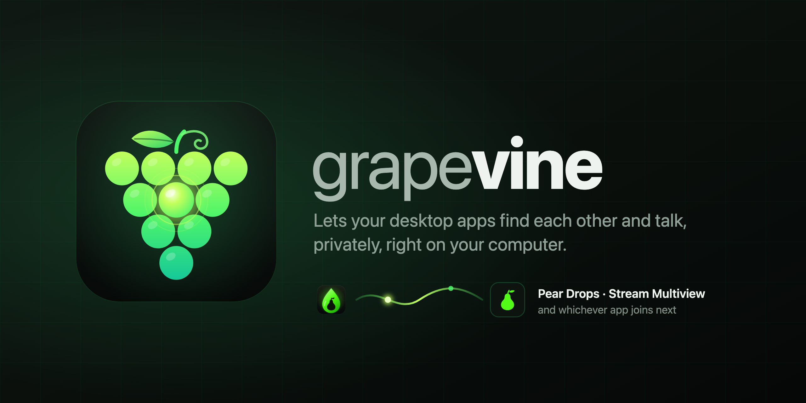

<p align="center"></p>

# Grapevine

Lets desktop apps on the same computer find each other and talk to each other directly. Nothing goes online, and there's no account or server.

It's how [**Pear Drops**](https://github.com/Stream-Orchard/pear-drops) tells [**Stream Multiview**](https://github.com/GlowingPear/stream-window-multiview) when it's farming drops, so multiview's Kick players sign out and leave the drop credit to Pear Drops. Any app that installs it can join in.

[](https://github.com/Stream-Orchard/grapevine/actions/workflows/test.yml) [](https://www.npmjs.com/package/@streamorchard/grapevine)  

---

## What it does

- **Finds apps.** Each app listens on a socket in one private folder (a named pipe on Windows), so apps see each other as they start and stop.
- **Connects safely.** Two apps pair the first time you switch the link on in both, and after that prove it's them every time. Web pages, other computers and unpaired programs can't connect.
- **Talks.** Apps send each other events ("farming PixelPear now") and answer requests, as [JSON-RPC 2.0](https://www.jsonrpc.org/specification). Every message is checked against its schema.
- **Copes with updates.** Each feature is a versioned _capability_. Apps agree the newest version both support, and when one is out of date, they say which one to update.
- **Recovers.** If an app quits or crashes, the other knows at once, and they reconnect when it's back.

It has no dependencies, needs nothing from Electron, and runs on Windows, macOS and Linux with Node 22 or later. [`PROTOCOL.md`](PROTOCOL.md) has the whole protocol.

## Install

```sh
npm install @streamorchard/grapevine
```

## Use it

```js
const { app, safeStorage } = require('electron');
const path = require('path');
const { createLink, fileKeyStore } = require('@streamorchard/grapevine');

const link = createLink({
  app: {
    id: 'com.streamorchard.peardrops', // your app's install id
    slug: 'pear-drops', // its socket name
    name: 'Pear Drops',
    version: app.getVersion(),
    icon: path.join(__dirname, 'icon.png'),
  },
  provides: { 'drops.farming': '1.0' }, // what it tells other apps
  uses: { players: '1.0' }, // what it listens to
  allowed: (appId) => settings.connectedApps[appId]?.enabled === true, // your Connected apps switches
  keys: fileKeyStore(path.join(app.getPath('userData'), 'grapevine.json'), {
    encrypt: (t) => safeStorage.encryptString(t).toString('base64'),
    decrypt: (t) => safeStorage.decryptString(Buffer.from(t, 'base64')),
  }),
  appDataDir: app.getPath('appData'), // to show "Not installed" for apps that aren't
});

await link.start();

// Tell every app that subscribed. seq and at are added for you.
link.publish('drops.farming.changed', {
  state: 'farming',
  account: { platform: 'kick', user: 'pearfan' },
  channel: { platform: 'kick', slug: 'pixelpear' },
  drop: null,
});

// Hear what the other apps provide.
link.on('event', (fromAppId, name, params) => {
  if (name === 'players.changed') console.log(params.platforms.kick?.signedIn);
});

// Ask one of them something.
const players = await link.request('com.glowingpear.streammultiview', 'players.get');

// When a Connected apps switch changes:
link.refresh();

// When the app quits:
await link.stop();
```

Editors suggest every event's fields and underline mistakes, in plain JavaScript too. The types come from the schemas.

### A Connected apps page

`link.peers()` lists every known app with what its card needs, and `link.on('change', …)` says when to draw it again.

| Field                                 |                                                                                                            |
| ------------------------------------- | ---------------------------------------------------------------------------------------------------------- |
| `name`, `summary`, `icon`, `download` | The app's logo (bundled, so it shows even when it isn't installed), one line about it, and where to get it |
| `installed`                           | Whether its data folder exists (with `appDataDir`)                                                         |
| `enabled`                             | Your switch for it                                                                                         |
| `status`                              | `off`, `waiting`, `connected`, `pair-again` or `incompatible`                                              |
| `reason`                              | Why it's waiting: `switched-off` (its own switch is off), `disconnected-there`                             |
| `keyHeldBy`                           | For `pair-again`: `us` means show **Pair again** here, `them` means it's pressed in the other app          |
| `version`, `report.text`              | While connected: its version, and "Works" or what's missing ("update Pear Drops to 0.1.7 or later")        |
| `pairedAt`, `keysEncrypted`           | When they paired, and whether keys are stored encrypted                                                    |

Two calls go with buttons on the card:

- **Disconnect:** `link.disconnect(appId)`. Turn your own switch for that app off too.
- **Pair again:** `link.pairAgain(appId)`.

### In your app's tests

A stand-in plays the other app, at any version, so your tests don't need it installed:

```js
const { standInPeer } = require('@streamorchard/grapevine/stand-in-peer');
const peer = await standInPeer({ as: 'com.glowingpear.streammultiview', dir: testDir, uses: { 'drops.farming': '1.0' } });
peer.link.on('event', (from, name, params) => {
  /* … */
});
```

Give your app the same `GRAPEVINE_DIR` (or `place: { env: { GRAPEVINE_DIR: testDir } }`), so tests never touch the real folder.

From the command line, for launch tests, it prints a JSON line for everything that happens and takes commands on stdin:

```sh
npx grapevine-stand-in --as com.glowingpear.streammultiview --dir /tmp/test --uses drops.farming@1.0 --provides players@1.0
```

Example messages for every capability version, good and bad, are in `@streamorchard/grapevine/fixtures`. Check that what your app sends passes them.

## Capabilities

| Capability          | Provided by      | What it says                                                       |
| ------------------- | ---------------- | ------------------------------------------------------------------ |
| `drops.farming` 1.0 | Pear Drops       | Whether it's farming, which channel, and the drop's progress       |
| `players` 1.0       | Stream Multiview | Its players by site: signed in or not, and which channels are open |

To add one:

1. Write `schemas/<name>/1.json`, with an example of each event in `fixtures/<name>/1/`, good and bad.
2. Run `npm run types`.

To change one, follow [the version rules](PROTOCOL.md#versions): additions are a minor version, anything else a new major alongside the old one.

## Adding an app

Add it to `src/known-apps.js`, with its id, slug, summary, a 256×256 logo in `assets/apps/`, its download page and its data folder's name. Every app that updates Grapevine then shows it on its Connected apps page.

## Developing

```sh
npm test               # every test, real sockets included
npm run test:coverage  # with the coverage minimums
npm run lint           # ESLint and Prettier
npm run format         # fix what lint can
npm run types          # types/capabilities.d.ts from the schemas
npm run check          # the types are up to date, and tsc finds no type errors
```

CI runs the tests on Windows, macOS and Linux, and lint, types and coverage on Linux.

**Releasing:**

1. In a pull request, change `version` in `package.json` and add a section to `CHANGELOG.md`.
2. Once it's merged, publish a GitHub release tagged `v<version>`.
3. The **Publish** workflow tests it and stages it on npm, with provenance. No npm token is stored anywhere, and the workflow can only stage.
4. Approve the staged version on npmjs.com (with your two-factor code) to make it live.

## License

[GPL-3.0](LICENSE). Apps that use Grapevine must be GPL-compatible.
